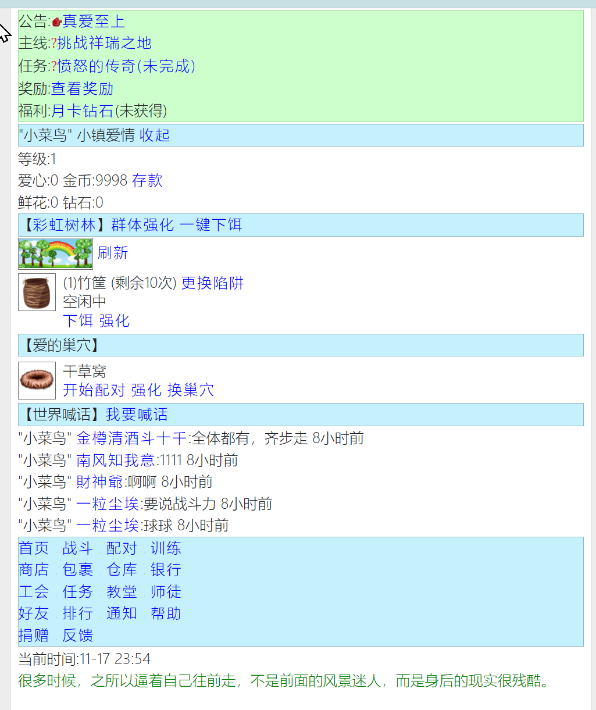
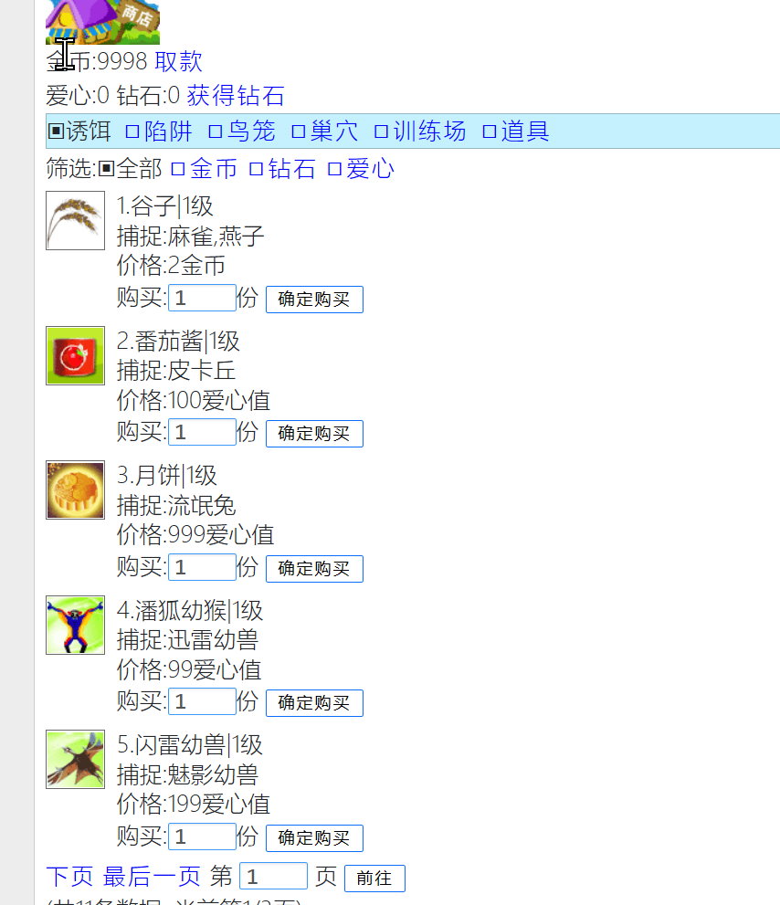
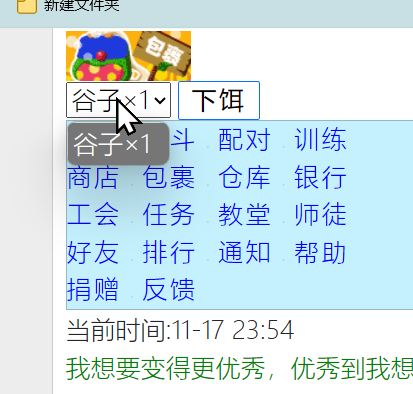

# game-bird

## 目录

- [介绍](#介绍)
- [软件架构](#软件架构)
- [项目结构](#项目结构)
- [版本状态](#版本状态)
- [快速开始](#快速开始)
  - [环境要求](#环境要求)
  - [构建与测试](#构建与测试)
  - [运行](#运行)
  - [Docker 部署](#docker-部署)
- [使用说明](#使用说明)
- [路由](#路由)
  - [三域路由对照表](#三域路由对照表game--trap--chat)
  - [命名约定](#命名约定)
  - [硬编码 `.do` 字面量清零](#硬编码-do-字面量清零)
- [路径规范化](#路径规范化)
- [已知问题](#已知问题)
- [贡献指南](#贡献指南)
- [截图](#截图)

---

## 介绍

WAP 游戏「小鸟情人」。玩家在多个场景中放置陷阱、投放诱饵、捕捉小鸟，
并通过商店购买道具、在包裹中使用道具、在仓库管理捕获物。

**核心玩法循环**：

```
商店购买诱饵/陷阱/鸟笼/巢穴/训练场/道具 → 包裹使用（装载陷阱/巢穴/训练场/装备鸟笼）
→ 陷阱下饵（可涂粘性道具降逃脱）→ 等待捕捉到期（可钻石加速）→ 收网结算（成长/克制随机、可能逃脱）
→ 仓库管理（出售/设出战）→ 小鸟训练升级 / 配对孵化（自家或好友跨玩家配对）
→ 战斗（挑战真实玩家的鸟，胜抢金币）/ 任务 / 签到 / 教堂结婚
```

**近期已完成的基础性工作**（详见 [已知问题](#已知问题) 与提交历史）：

- 全项目路由去掉 `.do` 后缀（262 处 → 0），统一为 REST 风格
- 商店购买逻辑去重（6 个逐字重复的方法 → 1 个 `ShopPurchaseService`）
- 包裹列表、模板骨架、数值加减逻辑去重
- 安全整改：数据库凭据外置、CORS 白名单化、Session Cookie 加固、405 语义修正
- `com.qq2008` 根包更名为 `com.gamebird`（见 [软件架构](#软件架构)）
- 新增跨平台路径规范化工具 `PathNormalizer` / `PathOps`（见 [路径规范化](#路径规范化)）
- **玩法补全批次（2026-11）**：包裹 5 类道具「使用」全量接线、逃脱/耐久/仓库上限
  玩法化、训练与配对（含好友跨玩家）闭环、真实玩家战斗、任务触发器、每日签到、
  树林记录/世界动态开放、改密 + BCrypt 透明哈希升级、商品详情页、教堂求婚/离婚、
  谁在玩。详见 [`docs/改动说明-20261101.md`](docs/改动说明-20261101.md)

## 软件架构

- **语言**：Java 17
- **框架**：Spring Boot 3.2.7 + MyBatis-Plus 3.5.7 + Thymeleaf
- **数据库**：MySQL 8.0
- **其他**：Lombok、mybatis-plus-join
- **构建**：Maven（多阶段容器构建见 [`docker/`](docker/README.md)）

> 注：实际使用的是 **MyBatis-Plus**（含 `mybatis-plus-join`），不是裸 MyBatis。

**根包名**：`com.gamebird`（2026-10 由 `com.qq2008` 更名，更名涉及 205 个文件，
含 180 个 `package` 声明、383 条 `import`、25 个 Mapper XML 的 `namespace`
及磁盘目录；构建与部署配置不受影响，因项目无自身 `groupId`）。

## 项目结构

`src/main/java` 下 174 个 Java 文件，分 `common`（通用设施）与 `game.bird`（业务主体）两棵子树：

```
com/gamebird/
├── common/                          ← 与小鸟游戏无关的通用件
│   ├── annotation/            2     注解（含 @SkipRole）
│   ├── entity/                3     Result / ResultCode / BizException
│   └── util/                  4     CommonUtils / JSONUtils / ArrayUtils / UUIDUtils
└── game/bird/                        ← 业务主体
    ├── assembler/             1     RolePackAssembler（VO 装配）
    ├── config/                8     ServerConfig / GameCorsProperties / GameProperties /
    │                                 GameConfigGateway / GameConfigManager / GameServer /
    │                                 GlobalExceptionHandler / MyBatisConfig
    ├── config/interceptor/    4     三个拦截器 + WebMvcConfigurer
    ├── config/listener/       2     ServerStartedListener 等
    ├── controller/           19     account 1 / common 1 / game 17
    ├── data/                  3     ConstData / RandomTextData / ShopItemAccessors
    ├── mapper/               25     MyBatis-Plus 的 IService 接口
    ├── model/
    │   ├── dbo/              25     实体，与 25 张表一一对应
    │   ├── message/           3     MessageVO / MessageType / MessageLink（消息提示页）
    │   ├── shop/              4     ShopKind / ShopItemView / FeeKind 等
    │   └── vo/                8     视图对象
    ├── service/              28     业务接口
    ├── service/impl/         25     实现类
    └── util/                  9     GameUtils / BirdTextUtils / PathNormalizer / PathOps 等
```

其他目录：

```
src/main/resources/
├── application.properties      datasource、Session Cookie、CORS 配置
├── mapper/                     25 个 XML，与 mapper 接口同名（namespace 必须逐字一致）
├── static/                     css/js/images，全部挂到 /assets/** 路由下
└── templates/                  41 个 Thymeleaf 模板，按业务域分 12 个子目录
```

测试位于 `src/test/java/com/gamebird/`，6 个测试类共 **158 个用例**。

## 版本状态

当前版本 `0.0.1-SNAPSHOT`（见 `pom.xml`）。已实现的功能域：

| 域 | 状态 |
|---|---|
| 账号 | 注册 / 登录 / 退出 / **修改密码（BCrypt 透明升级）** |
| 角色 | 建角 / 头像 / 称号 / 性别（需卡）/ 昵称（需卡）/ 签名 / 银行存取（有上限） |
| 商店 | 6 类道具的列表 / **详情页** / 购买 |
| 包裹 | 6 类道具的列表与**使用（全量可用）** |
| 陷阱 | 购买 / 装载 / 一键下饵 / 下饵（可涂粘性道具）/ **钻石加速** / 收网结算（逃脱机制） |
| 训练 | 装入训练场 / 送鸟入训 / 到期结算（鸟升级）/ 中途取回 |
| 配对 | 自家两只异性鸟配对 / **好友跨玩家配对（邀请-确认）** / 收获结晶 / 换巢穴 |
| 战斗 | **挑战真实玩家仓库鸟** / 战力综合胜率 / 抢金币 / 冷却 / 战绩 |
| 任务 | 每日登录 / 捕捉 / 购买三类**自动触发与领奖** |
| 福利 | **每日签到**（连签奖励 + 钻石） |
| 聊天 | 世界 / 公会频道 |
| 仓库 | 小鸟列表 / 出售（含确认页）/ **设出战鸟** / 锁定保护 |
| 教堂 | **对戒求婚（4 档）** / 玫瑰示好 / 离婚手续费 |
| 动态 | **树林记录 / 世界动态**（log_tree 事件流）/ **谁在玩** |
| 其他 | 公会 / 好友 / 排行 / 公告 / 活动 / 充值引导 |

## 快速开始

### 环境要求

- JDK 17
- Maven 3.8+
- MySQL 8.0（或直接用 Docker）

### 构建与测试

```bash
mvn -B clean test                                # 158 个单元测试，必须全绿
mvn -B clean package -Pcontainer -DskipTests     # 容器用 fat jar（35MB）
```

> ⚠️ **`-Pcontainer` 不能漏**。上游 `pom.xml` 未声明 `spring-boot-maven-plugin`，
> 不带该 profile 会打出 **1.5MB 普通 jar**（无 `Main-Class`、无内嵌依赖），
> 容器会进重启循环。部署前用 `ls -lh target/*.jar` 确认是 35M。
> 详见 [`docker/README.md`](docker/README.md)。

### 运行

```bash
# 1. 导入初始数据（25 张表）
mysql -uroot -p game_bird < sql/game_bird.sql

# 2. 配置数据库连接（凭据已外置，见下）
export DB_USERNAME=root
export DB_PASSWORD=<你的密码>
# 也可选：DB_URL（默认 jdbc:mysql://localhost:3306/game_bird）

# 3. 启动
java -jar target/game-bird-0.0.1-SNAPSHOT.jar
```

访问 **http://127.0.0.1:80**。

**关于数据库配置**：连接信息在 `src/main/resources/application.properties`，
凭据通过 `${DB_USERNAME:root}` / `${DB_PASSWORD:root}` 注入
（默认值仍为 `root`/`root`，生产环境请用环境变量覆盖）。
Docker 部署时读 `docker/.env`。

### Docker 部署

```bash
cd docker
docker compose up -d --build     # 首次约 3 分钟
docker compose ps
docker compose logs -f app
```

访问 **http://127.0.0.1:9090**（仅绑定回环，局域网与公网不可达）。
完整说明（架构、数据管理、备份、故障排查、两个构建陷阱）见
[`docker/README.md`](docker/README.md)。

## 使用说明

1. 注册账号 → 登录 → 创建角色（角色名必填）
2. 进入游戏主页，可查看状态、前往商店 / 包裹 / 陷阱 / 聊天
3. 商店购买诱饵与陷阱 → 包裹中使用诱饵 → 陷阱收网结算
4. 银行可存取金钱；头像 / 称号 / 性别 / 昵称 / 签名可在角色页修改

**置灰的入口**表示「功能规划中、尚未实现」，点击无反应而非报错，详见
[已知问题](#已知问题)。

## 路由

全项目**已无 `.do` 后缀**（基线 262 处 → 0 处业务引用）。

```bash
# 应输出 4 行，全部是说明性注释（解释「为什么不要写 .do」的反面教材）
grep -rn '\.do\b' src/
# 硬编码 .do 字面量，应输出 0 行
grep -rnoE '(href|action)="/[^"]*\.do"' src/
```

残留的 4 处注释：`ConstData.java:77`（说明为何删掉硬编码 `.do` 路由常量）、
`GameStatusHandlerInterceptor.java:27`（举例 `"/message.do"` 是写法错误的反面教材）、
`GlobalExceptionHandler.java:102-103`（说明 `.do` 去后缀后为何要修 404）。

### 三域路由对照表（game / trap / chat）

| 原路由（含 `.do`） | 现路由 | Method | 视图 / 行为 |
|---|---|---|---|
| `/game.do` | `/game`（或裸 `/`） | GET | `game` 游戏主页 |
| `/bank.do` | `/bank` | GET | `role/bank` |
| `/bankIn.do` | `/bankIn` | POST | 存款 |
| `/bankOut.do` | `/bankOut` | POST | 取款 |
| `/field/info.do` | `/field/info` | GET | 场地信息 |
| `/profile.do` | `/profile` | GET | `role/profile` 角色状态 |
| `/pay.do` | `/pay` | GET | 获得钻石 |
| `/trap/useBait.do` | `/trap/useBait` | GET + POST | 同一路径按 method 区分读写 |
| `/trap/autoUseBait.do` | `/trap/autoUseBait` | GET + POST | 同一路径按 method 区分读写 |
| `/trap/over.do` | `/trap/over` | GET | 收网结算（**保持 GET，见已知问题**） |
| `/trap/birdInfo.do` | `/trap/birdInfo` | GET | 鸟信息（只读 `base_bird` 配置） |
| `/chat/list.do` | `/chat/list` | GET | 聊天大厅 |
| `/chat/chatWorld.do` | `/chat/chatWorld` | POST | 世界喊话 |

### 命名约定

**同一资源路径下用 HTTP method 区分读写**（`GET /trap/useBait` 查看、
`POST /trap/useBait` 提交），不再为读写各起一条路径。

**游戏主页统一走 `/game`**：`GameController` 保留 `{"/", "/game"}` 两个别名
（裸 `/` 是历史入口，保留兼容），但模板内所有引用一律写 `@{/game}`，不混用。

**根 `/profile` 与 `/role/profile` 不冲突**：`GameController` 只有 `@Controller`、
无类级 `@RequestMapping`，方法路径落在根路径；`RoleController` 有
`@RequestMapping("/role")`。两者渲染同一视图 `role/profile`（同一功能的两条路径），
`GameController.pageProfile` 已加注释说明区别。**合并会破外部链接，属路由行为变更。**

### 硬编码 `.do` 字面量清零

改造前有两处 `href`/`action` **不带 `@{}`**，是批量替换时最易漏的点：

| 位置 | 原写法 | 现写法 |
|---|---|---|
| `templates/trap/bait.html:18` | `<form action="/trap/useBait.do" method="post">` | `<form th:action="@{/trap/useBait}" method="post">` |
| `templates/game.html:133` | `<a href="/chat/list.do">我要喊话</a>` | `<a th:href="@{/chat/list}">我要喊话</a>` |

硬编码路径不经 Thymeleaf，**不会渲染上下文路径**，应用挂在非根 context 时必然 404。
其余 6 处 `<form action="">` 均为空 action（提交到当前页），无需处理。

## 路径规范化

`com.gamebird.game.bird.util.PathNormalizer` 与 `PathOps` 提供跨平台路径规范化能力，
处理用户输入或外部来源的路径，统一规则后再交给 `java.nio.file`。

**核心规则**：

| 规则 | 约定 |
|---|---|
| 分隔符 | 统一为正斜杠 `/`（项目部署于 Docker/Linux） |
| 大小写 | **目录段转小写**（`GameData` 与 `gamedata` 在 Linux 是两个目录、Windows 是同一个）；文件基名保留原大小写（`README.md` 不改）；扩展名转小写 |
| 非法字符 | `<>:"|?*` 与控制字符替换为 `_`（降级而非抛错，输入多来自用户） |
| 越界 `..` | 判据是「有无根可停」：绝对路径触根后停在根；相对路径无根、越界即抛 `PathNormalizationException` |
| 保留名 | `CON`/`PRN`/`AUX`/`NUL`/`COM1`-`COM9`/`LPT1`-`LPT9` 抛类型化错误（Windows 上无法创建） |
| glob | 自实现正则转换（`*` 不跨层、`**` 跨层、`{a,b}` 枚举），全平台行为一致 |

**为什么必须先规范化再用 `Path.of`**：Windows 上 `Paths.get("C:/data/a<b.txt")`
会直接抛 `InvalidPathException`，**根本到不了规范化逻辑**；且 `Path.of` 既不统一
分隔符也不管大小写，`a\b` 与 `a/b` 会变成两个不同的 `Path` 对象。

**使用方式**：业务侧读写文件统一走 `PathOps`（每个方法第一行即调用 `PathNormalizer`），
不要直接写 `Files.readString(Path.of(userInput))` —— 那会绕过全部规则。

> `PathOps` 当前暂无业务调用方，属**预留的收口入口**，静态分析若提示「未使用」属预期，
> 请勿删除。

## 已知问题

历史批次遗留的已知问题清单。**加粗项已在玩法补全批次（2026-11）解决**，
保留条目供追溯；完整改动见 [`docs/改动说明-20261101.md`](docs/改动说明-20261101.md)。

### 1. ~~修改密码功能已移除（死路由）~~ 已实现

原作从未实现的改密功能已补齐：`GET/POST /account/password`。口令存储同步升级为
**BCrypt 哈希**（`spring-security-crypto` 单依赖）：新注册直接存哈希；存量明文账号在
下一次登录验证通过时**透明升级**为哈希（`PasswordHasher`，26 个门禁用例）。

### 2. ~~商品详情页从未实现~~ 已实现

6 类商品共用一个详情模板 `GET /shop/{kind}/detail?id=`，商店列表的商品名已挂链接，
详情页内直接可购买。

### 3. ~~26 处死链置灰~~ 已全部接线

包裹 5 类「使用」、主页「更换陷阱/加速/签到/公告/任务」、树林记录、世界动态、
配对、谁在玩、银行上限提示、结算页三个跳转，全部改为真实路由（写操作一律 POST）。
`grep -rn '功能开发中，暂不可用' src/main/resources/templates/ | wc -l` 现应为 **0**。

### 4. ~~主页两个内容面板不可见~~ 已开放

「树林记录」（个人）与「世界动态」（全服）均以 `log_tree` 表为数据源，
由 `GameEventService` 在收网/逃脱/孵化/训练/战斗/求婚/离婚时写入，
主页去 hidden 接线，并新增全部动态页 `GET /game/tree`。

### 5. 捕捉结算页仍是一次性渲染（有意保留）

`POST /trap/over`（已由 GET 改 POST）展示的成长/克制值来自本次捕捉的内存结算对象，
收网后槽位清零，页面不可按 birdId 重开。如需「历史结算回查」，属新增功能需单独立项；
当前可在仓库页查看小鸟的完整数值。

### 6. `ko` 的 `/100` 语义待产品确认

结算页克制值仍走 `BirdTextUtils.koText(ko)` 的 /100 约定。本批次把 ko 从写死 0
改为随机 0~100（页面显示 0.00%~1.00%），但业务含义（克制对象/作用）仍待确认，
`base_bird` 的 s/r/lvu 等配套字段同样未启用。

### 7. ~~购买失败提示不一致~~ 已统一（前一批次）

诱饵域与陷阱域共用 `ShopPurchaseService`，失败提示结构一致。

### 8. ~~`/trap/over` 是 GET 写操作~~ 已改为 POST

收网按钮在主页与结算触发均为 POST 表单，浏览器预取/刷新不再重复收网。

### 9. 尚未实现的遗留玩法（非缺陷，是待办）

- 主线/支线任务链（现只有三类日常任务触发器）
- 金蛋/徒弟/出征/入侵等主页 hidden 占位
- 天赋/成长药剂之外的基因道具细化（双倍经验卡等 buff 类需时长字段）
- 消耗型道具的部分效果（effect_type 5/6/7/11/12/14/22 等）待逐项接入

## 贡献指南

提交规范、分支命名、红线清单（不可改的字段 / 端口 / Cookie 名 / session key）、
已知陷阱见 **[`CONTRIBUTING.md`](CONTRIBUTING.md)**。

编号释义（`RT-n` / `Rn` / `Q-x` / `D-x` / `Un`）见
**[`docs/规范/编号词汇表.md`](docs/规范/编号词汇表.md)**。

## 截图






