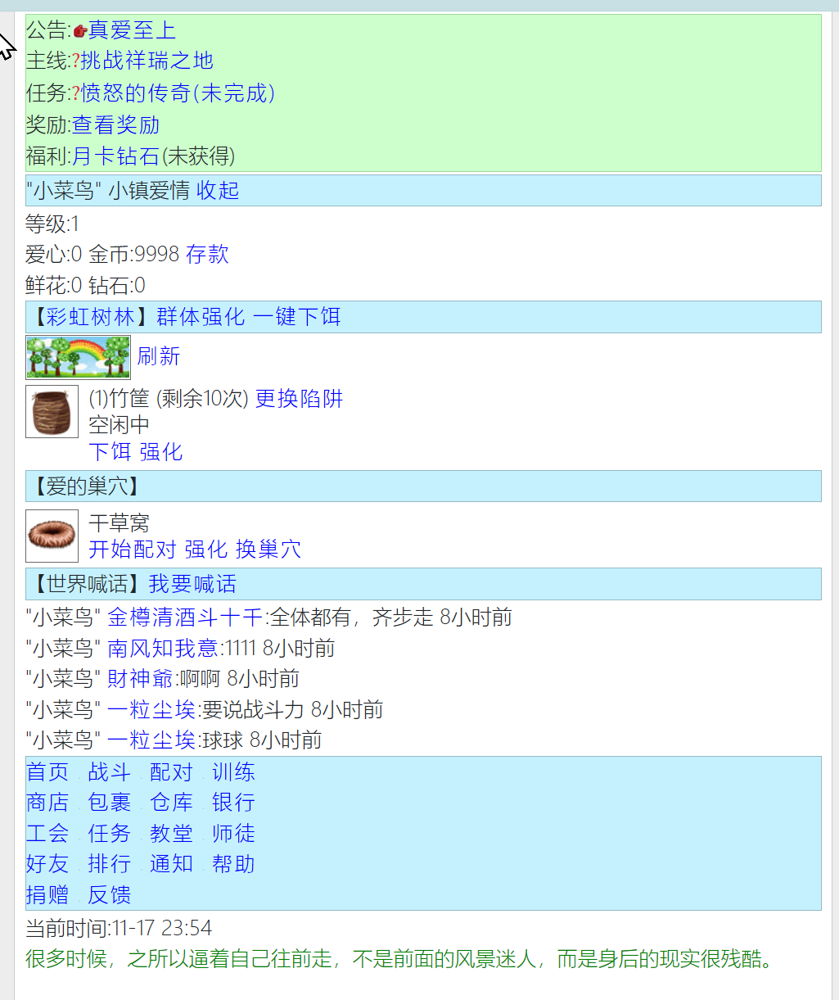
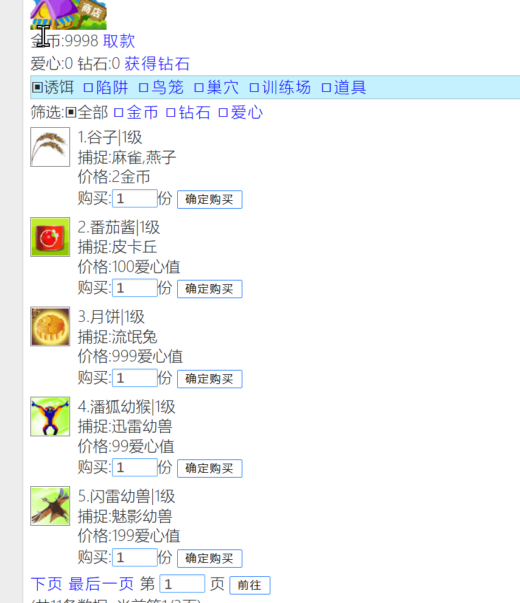
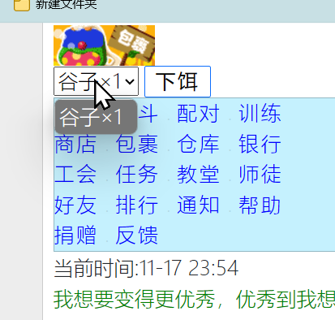

# game-bird

## 目录

- [介绍](#介绍)
- [软件架构](#软件架构)
- [项目结构](#项目结构)
- [版本状态](#版本状态)
- [快速开始](#快速开始)
  - [环境要求](#环境要求)
  - [构建与测试](#构建与测试)
  - [运行](#运行)
  - [Docker 部署](#docker-部署)
- [使用说明](#使用说明)
- [路由](#路由)
  - [三域路由对照表](#三域路由对照表game--trap--chat)
  - [命名约定](#命名约定)
  - [硬编码 `.do` 字面量清零](#硬编码-do-字面量清零)
- [路径规范化](#路径规范化)
- [已知问题](#已知问题)
- [贡献指南](#贡献指南)
- [截图](#截图)

---

## 介绍

WAP 游戏「小鸟情人」。玩家在多个场景中放置陷阱、投放诱饵、捕捉小鸟，
并通过商店购买道具、在包裹中使用道具、在仓库管理捕获物。

**核心玩法循环**：

```
商店购买诱饵/陷阱 → 包裹使用诱饵 → 陷阱下饵 → 等待捕捉到期 → 收网结算 → 仓库管理
```

**近期已完成的基础性工作**（详见 [已知问题](#已知问题) 与提交历史）：

- 全项目路由去掉 `.do` 后缀（262 处 → 0），统一为 REST 风格
- 商店购买逻辑去重（6 个逐字重复的方法 → 1 个 `ShopPurchaseService`）
- 包裹列表、模板骨架、数值加减逻辑去重
- 安全整改：数据库凭据外置、CORS 白名单化、Session Cookie 加固、405 语义修正
- `com.qq2008` 根包更名为 `com.gamebird`（见 [软件架构](#软件架构)）
- 新增跨平台路径规范化工具 `PathNormalizer` / `PathOps`（见 [路径规范化](#路径规范化)）

## 软件架构

- **语言**：Java 17
- **框架**：Spring Boot 3.2.7 + MyBatis-Plus 3.5.7 + Thymeleaf
- **数据库**：MySQL 8.0
- **其他**：Lombok、mybatis-plus-join
- **构建**：Maven（多阶段容器构建见 [`docker/`](docker/README.md)）

> 注：实际使用的是 **MyBatis-Plus**（含 `mybatis-plus-join`），不是裸 MyBatis。

**根包名**：`com.gamebird`（2026-10 由 `com.qq2008` 更名，更名涉及 205 个文件，
含 180 个 `package` 声明、383 条 `import`、25 个 Mapper XML 的 `namespace`
及磁盘目录；构建与部署配置不受影响，因项目无自身 `groupId`）。

## 项目结构

`src/main/java` 下 174 个 Java 文件，分 `common`（通用设施）与 `game.bird`（业务主体）两棵子树：

```
com/gamebird/
├── common/                          ← 与小鸟游戏无关的通用件
│   ├── annotation/            2     注解（含 @SkipRole）
│   ├── entity/                3     Result / ResultCode / BizException
│   └── util/                  4     CommonUtils / JSONUtils / ArrayUtils / UUIDUtils
└── game/bird/                        ← 业务主体
    ├── assembler/             1     RolePackAssembler（VO 装配）
    ├── config/                8     ServerConfig / GameCorsProperties / GameProperties /
    │                                 GameConfigGateway / GameConfigManager / GameServer /
    │                                 GlobalExceptionHandler / MyBatisConfig
    ├── config/interceptor/    4     三个拦截器 + WebMvcConfigurer
    ├── config/listener/       2     ServerStartedListener 等
    ├── controller/           19     account 1 / common 1 / game 17
    ├── data/                  3     ConstData / RandomTextData / ShopItemAccessors
    ├── mapper/               25     MyBatis-Plus 的 IService 接口
    ├── model/
    │   ├── dbo/              25     实体，与 25 张表一一对应
    │   ├── message/           3     MessageVO / MessageType / MessageLink（消息提示页）
    │   ├── shop/              4     ShopKind / ShopItemView / FeeKind 等
    │   └── vo/                8     视图对象
    ├── service/              28     业务接口
    ├── service/impl/         25     实现类
    └── util/                  9     GameUtils / BirdTextUtils / PathNormalizer / PathOps 等
```

其他目录：

```
src/main/resources/
├── application.properties      datasource、Session Cookie、CORS 配置
├── mapper/                     25 个 XML，与 mapper 接口同名（namespace 必须逐字一致）
├── static/                     css/js/images，全部挂到 /assets/** 路由下
└── templates/                  41 个 Thymeleaf 模板，按业务域分 12 个子目录
```

测试位于 `src/test/java/com/gamebird/`，6 个测试类共 **158 个用例**。

## 版本状态

当前版本 `0.0.1-SNAPSHOT`（见 `pom.xml`）。已实现的功能域：

| 域 | 状态 |
|---|---|
| 账号 | 注册 / 登录 / 退出 |
| 角色 | 建角 / 头像 / 称号 / 性别 / 昵称 / 签名 / 银行存取 |
| 商店 | 6 类道具的列表浏览与购买 |
| 包裹 | 6 类道具的列表与使用 |
| 陷阱 | 购买 / 投放诱饵 / 收网结算 |
| 聊天 | 世界 / 公会频道 |
| 仓库 | 小鸟存放（**列表与出售入口已置灰，见已知问题**） |

## 快速开始

### 环境要求

- JDK 17
- Maven 3.8+
- MySQL 8.0（或直接用 Docker）

### 构建与测试

```bash
mvn -B clean test                                # 158 个单元测试，必须全绿
mvn -B clean package -Pcontainer -DskipTests     # 容器用 fat jar（35MB）
```

> ⚠️ **`-Pcontainer` 不能漏**。上游 `pom.xml` 未声明 `spring-boot-maven-plugin`，
> 不带该 profile 会打出 **1.5MB 普通 jar**（无 `Main-Class`、无内嵌依赖），
> 容器会进重启循环。部署前用 `ls -lh target/*.jar` 确认是 35M。
> 详见 [`docker/README.md`](docker/README.md)。

### 运行

```bash
# 1. 导入初始数据（25 张表）
mysql -uroot -p game_bird < sql/game_bird.sql

# 2. 配置数据库连接（凭据已外置，见下）
export DB_USERNAME=root
export DB_PASSWORD=<你的密码>
# 也可选：DB_URL（默认 jdbc:mysql://localhost:3306/game_bird）

# 3. 启动
java -jar target/game-bird-0.0.1-SNAPSHOT.jar
```

访问 **http://127.0.0.1:80**。

**关于数据库配置**：连接信息在 `src/main/resources/application.properties`，
凭据通过 `${DB_USERNAME:root}` / `${DB_PASSWORD:root}` 注入
（默认值仍为 `root`/`root`，生产环境请用环境变量覆盖）。
Docker 部署时读 `docker/.env`。

### Docker 部署

```bash
cd docker
docker compose up -d --build     # 首次约 3 分钟
docker compose ps
docker compose logs -f app
```

访问 **http://127.0.0.1:9090**（仅绑定回环，局域网与公网不可达）。
完整说明（架构、数据管理、备份、故障排查、两个构建陷阱）见
[`docker/README.md`](docker/README.md)。

## 使用说明

1. 注册账号 → 登录 → 创建角色（角色名必填）
2. 进入游戏主页，可查看状态、前往商店 / 包裹 / 陷阱 / 聊天
3. 商店购买诱饵与陷阱 → 包裹中使用诱饵 → 陷阱收网结算
4. 银行可存取金钱；头像 / 称号 / 性别 / 昵称 / 签名可在角色页修改

**置灰的入口**表示「功能规划中、尚未实现」，点击无反应而非报错，详见
[已知问题](#已知问题)。

## 路由

全项目**已无 `.do` 后缀**（基线 262 处 → 0 处业务引用）。

```bash
# 应输出 4 行，全部是说明性注释（解释「为什么不要写 .do」的反面教材）
grep -rn '\.do\b' src/
# 硬编码 .do 字面量，应输出 0 行
grep -rnoE '(href|action)="/[^"]*\.do"' src/
```

残留的 4 处注释：`ConstData.java:77`（说明为何删掉硬编码 `.do` 路由常量）、
`GameStatusHandlerInterceptor.java:27`（举例 `"/message.do"` 是写法错误的反面教材）、
`GlobalExceptionHandler.java:102-103`（说明 `.do` 去后缀后为何要修 404）。

### 三域路由对照表（game / trap / chat）

| 原路由（含 `.do`） | 现路由 | Method | 视图 / 行为 |
|---|---|---|---|
| `/game.do` | `/game`（或裸 `/`） | GET | `game` 游戏主页 |
| `/bank.do` | `/bank` | GET | `role/bank` |
| `/bankIn.do` | `/bankIn` | POST | 存款 |
| `/bankOut.do` | `/bankOut` | POST | 取款 |
| `/field/info.do` | `/field/info` | GET | 场地信息 |
| `/profile.do` | `/profile` | GET | `role/profile` 角色状态 |
| `/pay.do` | `/pay` | GET | 获得钻石 |
| `/trap/useBait.do` | `/trap/useBait` | GET + POST | 同一路径按 method 区分读写 |
| `/trap/autoUseBait.do` | `/trap/autoUseBait` | GET + POST | 同一路径按 method 区分读写 |
| `/trap/over.do` | `/trap/over` | GET | 收网结算（**保持 GET，见已知问题**） |
| `/trap/birdInfo.do` | `/trap/birdInfo` | GET | 鸟信息（只读 `base_bird` 配置） |
| `/chat/list.do` | `/chat/list` | GET | 聊天大厅 |
| `/chat/chatWorld.do` | `/chat/chatWorld` | POST | 世界喊话 |

### 命名约定

**同一资源路径下用 HTTP method 区分读写**（`GET /trap/useBait` 查看、
`POST /trap/useBait` 提交），不再为读写各起一条路径。

**游戏主页统一走 `/game`**：`GameController` 保留 `{"/", "/game"}` 两个别名
（裸 `/` 是历史入口，保留兼容），但模板内所有引用一律写 `@{/game}`，不混用。

**根 `/profile` 与 `/role/profile` 不冲突**：`GameController` 只有 `@Controller`、
无类级 `@RequestMapping`，方法路径落在根路径；`RoleController` 有
`@RequestMapping("/role")`。两者渲染同一视图 `role/profile`（同一功能的两条路径），
`GameController.pageProfile` 已加注释说明区别。**合并会破外部链接，属路由行为变更。**

### 硬编码 `.do` 字面量清零

改造前有两处 `href`/`action` **不带 `@{}`**，是批量替换时最易漏的点：

| 位置 | 原写法 | 现写法 |
|---|---|---|
| `templates/trap/bait.html:18` | `<form action="/trap/useBait.do" method="post">` | `<form th:action="@{/trap/useBait}" method="post">` |
| `templates/game.html:133` | `<a href="/chat/list.do">我要喊话</a>` | `<a th:href="@{/chat/list}">我要喊话</a>` |

硬编码路径不经 Thymeleaf，**不会渲染上下文路径**，应用挂在非根 context 时必然 404。
其余 6 处 `<form action="">` 均为空 action（提交到当前页），无需处理。

## 路径规范化

`com.gamebird.game.bird.util.PathNormalizer` 与 `PathOps` 提供跨平台路径规范化能力，
处理用户输入或外部来源的路径，统一规则后再交给 `java.nio.file`。

**核心规则**：

| 规则 | 约定 |
|---|---|
| 分隔符 | 统一为正斜杠 `/`（项目部署于 Docker/Linux） |
| 大小写 | **目录段转小写**（`GameData` 与 `gamedata` 在 Linux 是两个目录、Windows 是同一个）；文件基名保留原大小写（`README.md` 不改）；扩展名转小写 |
| 非法字符 | `<>:"|?*` 与控制字符替换为 `_`（降级而非抛错，输入多来自用户） |
| 越界 `..` | 判据是「有无根可停」：绝对路径触根后停在根；相对路径无根、越界即抛 `PathNormalizationException` |
| 保留名 | `CON`/`PRN`/`AUX`/`NUL`/`COM1`-`COM9`/`LPT1`-`LPT9` 抛类型化错误（Windows 上无法创建） |
| glob | 自实现正则转换（`*` 不跨层、`**` 跨层、`{a,b}` 枚举），全平台行为一致 |

**为什么必须先规范化再用 `Path.of`**：Windows 上 `Paths.get("C:/data/a<b.txt")`
会直接抛 `InvalidPathException`，**根本到不了规范化逻辑**；且 `Path.of` 既不统一
分隔符也不管大小写，`a\b` 与 `a/b` 会变成两个不同的 `Path` 对象。

**使用方式**：业务侧读写文件统一走 `PathOps`（每个方法第一行即调用 `PathNormalizer`），
不要直接写 `Files.readString(Path.of(userInput))` —— 那会绕过全部规则。

> `PathOps` 当前暂无业务调用方，属**预留的收口入口**，静态分析若提示「未使用」属预期，
> 请勿删除。

## 已知问题

以下问题**均已定位、刻意不在当前批次修复**，修复前请先读对应说明。

### 1. 修改密码功能已移除（死路由）

原作者从未实现：模板缺失 + POST 方法体是纯空壳（只 `return`，不查库不更新）+
全项目无任何入口链接。重构时移除了死路由，设计规格见
[`docs/规范/编号词汇表.md`](docs/规范/编号词汇表.md) 的 D-a 条目。

**注意：口令在数据库中仍为明文。** 实现改密前需先确定哈希方案。

### 2. 商品详情页从未实现（6 条死路由已移除）

6 种道具各有一条详情路由，方法体恒返回视图名，而 6 个模板从未存在，
重构前点进去必然 500。已移除。

### 3. 26 处死链已置灰，另 1 处为修正指向

全项目共 **27 处**指向不存在路由的链接：**26 处已置灰**（移除 `th:href`、
改用 `<span class="text-muted" title="功能开发中，暂不可用">`，文字与位置不变），
**1 处为修正指向**（`fragment/shop.html` 的取款，原 `/userBank.do` 零映射，
改指向真实存在的 `/bank`）。

置灰而非删除，是为了让玩家知道「这里有功能、只是还没做」。

```bash
grep -rn '功能开发中，暂不可用' src/main/resources/templates/ | wc -l    # 26
```

| 文件 | 处数 | 置灰内容 |
|---|---|---|
| `fragment/navigation.html` | 12 | 战斗、配对、训练、仓库、工会、任务、教堂、好友、排行、通知、帮助、谁在玩 |
| `game.html` | 5 | 公告「真爱至上」、主线「挑战祥瑞之地」、福利「签到」、「更换陷阱」、「加速」 |
| `pack/{cage,nest,prop,train,trap}.html` | 5 | 各包裹页的「使用」按钮 |
| `role/bank.html` | 1 | 存款「提升上限」（原指向 `/userBankUp`） |
| `trap/over.html` | 3 | 「仓库」（2 处，原 `/storage/bird.do`）、「马上出售」、「前往仓库」（原 `/storage/bird/sellConfirm.do(birdId=...)`） |

**实现时的通用约束**：凡消耗道具、变更状态的入口（道具「使用」、
存款「提升上限」、「更换陷阱」、「加速」）都应为 **POST** 而非 GET。

**`/trap/hasten.do`（`game.html` 的「加速」）是重构过程中新发现的死链**：
全仓仅此一处引用，Java 侧零 Controller 映射，不在原始规格的死链清单里
（规格遗漏），已按同规范置灰。若将来实现「加速」，应为 POST。

**诱饵的「使用」是另一条链路**：`pack/bait.html` 走 `@{/trap/useBait(...)}`，
该路由真实存在，未置灰。

### 4. 游戏主页两个内容面板均不可见，且接线状态不同

`game.html` 上有两个面板都带 `hidden="hidden"`，但**接线状态不一样**，
处理方式因此不同：

**「树林记录」面板 —— 已接线但不可见**（`game.html:141`）

整块 `hidden`，但 `:143-146` 确实用 `th:each` 读取了 `treeMessagePage`。
后端 `GameController` 也在算这份 mock 数据。属「已接线、待开放」的连贯状态，
**去掉 `hidden` 即可见**，无需其他改动。

**「世界动态」面板 —— 既未接线也不可见**（`game.html:150-156`）

整块 `hidden`，且 `:152-156` 是**写死的静态 `<li>` 示例文本**加一句「暂未开放」，
**没有任何 `th:each`，模板侧零读取后端数据**。

因此本项**已做的处理是删除后端的死计算**：原先 `GameController` 会调
`MockUtils.mockGlobalMessageList(7, role)` 生成一份 mock 数据并塞进 model，
但没有任何模板读它——那是算了也不会被展示的无效计算，
按「不计算没人读的数据」原则已删除，`mockGlobalMessageList` 方法一并移除。

**要真正开放「世界动态」需同时做两件事**（属功能开发，不在规范化批次范围）：

1. **模板接线**：去掉 `hidden`，把写死的 `<li>` 示例换成
   `th:each="message : ${globalMessagePage.getRecords()}"` 遍历；
2. **真实数据源**：当前没有「世界动态」的数据表或查询逻辑，
   mock 只能让页面「有东西可看」，开放前需确定数据来源
   （是全服聊天记录，还是独立的事件流）。

### 5. 捕捉结算页是一次性渲染，无按 birdId 重开入口

`GET /trap/over` 展示的成长/克制值**来自本次捕捉流程的内存对象**，
不是从 `storage_bird` 回读：

- `TrapController.doOver` 收网后把 `role_trap` 的 `catch_*` 字段全部清零
  （`TrapController.java:238-245`），没有「待结算」中间态；
- 页面文案取自 `BirdTextUtils.growText(bird.getGrow())`
  （`TrapController.java:265-266`），`bird` 是本次捕捉时生成并落库的内存实例；
- `GET /trap/birdInfo` 只读 `base_bird` 配置（类型/重量/单价/经验），**不含成长值**。

**这是既有设计事实，不是本轮引入的缺陷。** 任何想验证或排查成长值的人都会撞到
同一堵墙：改库后无法通过重开页面观察变化。已验证记录见
[`docs/验证记录/改库验证-成长值.md`](docs/验证记录/改库验证-成长值.md)。

若未来需要按 birdId 重查历史结算，属**新增功能**，需单独立项。

### 6. `ko` 的 `/100` 语义待产品确认

结算页克制值走 `BirdTextUtils.koText(ko)`，`ko` 存的是放大 100 倍的整数
（实测 `ko=0` 显示 `0.00%`）。这个 `/100` 约定**未见任何规格文档或注释说明**，
是逆向推断的结果。当前 `base_bird` 数据全部为 0，无法用真实数据反推验证。

**待产品确认**：`ko` 的业务含义、取值范围、以及是否恒为 0
（若恒为 0，则整个 `ko` 链路疑为未实现的占位）。

### 7. 购买失败提示在两个域之间不一致

| 域 | 表现 |
|---|---|
| **诱饵域** `POST /shop/bait/purchase` | 货币/数量不足时**返回 200 且带提示块**，例如「您的爱心值不足(0/399)。」 |
| **陷阱域** `POST /shop/trap/purchase` | 同样失败时**返回 200 但响应体为空**，页面上看不到任何提示 |

**定位依据**：实测购买 `base_trap` id=18（`fee_type=3`，即爱心计价）时失败，
把角色 `level` 提到 20 仍失败——**说明并非等级门槛，而是货币种类分支**：
角色爱心为 0，而诱饵域的对应分支有兜底提示、陷阱域的对应分支没有。

### 8. `GET /trap/over` 仍是 GET 写操作（已知设计债）

`TrapController.doOver` 会消耗陷阱并结算捕获（**写库**），却仍是 `@GetMapping`。
按 REST 语义应为 POST。**本轮有意不改**：改 POST 需同步改造 `trap/over` 页的
触发方式。已知缺陷是浏览器预取或刷新可能重复触发收网。

### 9. 维护页路由曾三方不一致（已修）

改造前 `GameController` 的映射是 `/message.do`，而拦截器的转发目标与排除列表都写
`/message` —— **维护态下 forward 到一个不存在的映射，必然 404**。现已三方统一为
`/message`，由 `ConstData.MESSAGE_PATH` 单一来源提供，并加了与配置无关的兜底：
`GameStatusHandlerInterceptor` 在 forward 前先打 `MESSAGE_FORWARDED` 标记，
即使 exclude 列表被误改，退化结果也只是「重复 forward」而非 `StackOverflowError`。

### 10. MVC 配置迁移后 `/assets/**` 完全依赖手工注册

`ServerWebMvcConfigurationSupport`（类名是历史遗留，现已实现 `WebMvcConfigurer`
而非继承 `WebMvcConfigurationSupport`）原继承基类会让 Spring Boot 的
`WebMvcAutoConfiguration` 整体失效。已改为实现接口，显式的 `/assets/**` 与
`/favicon.ico` 映射保留并实测有效（`bootstrap5.3.2.css` 292880B、
`favicon.ico` 1742B 均 200）。

但耦合度上升：**显式映射漏掉不会有任何启动期报错**，只会在运行时 404。

### 11. 路由去掉 `.do` 是破坏性变更

所有外部书签、直链已失效。旧链接现在返回 **404**（`ebde759` 修复后）
而非 500，便于使用者识别。分支含 18 个带 `BREAKING CHANGE:` 的提交。

### 12. 根包已更名，全限定名引用方受影响

`com.qq2008` → `com.gamebird`，涉及 205 个文件。任何按全限定名
（如 `com.qq2008.game.bird.util.GameUtils`）引用本项目的代码都会失效。
Maven 坐标不受影响（项目无自身 `groupId`，坐标仍为 `game-bird`）。

## 贡献指南

提交规范、分支命名、红线清单（不可改的字段 / 端口 / Cookie 名 / session key）、
已知陷阱见 **[`CONTRIBUTING.md`](CONTRIBUTING.md)**。

编号释义（`RT-n` / `Rn` / `Q-x` / `D-x` / `Un`）见
**[`docs/规范/编号词汇表.md`](docs/规范/编号词汇表.md)**。

## 截图






